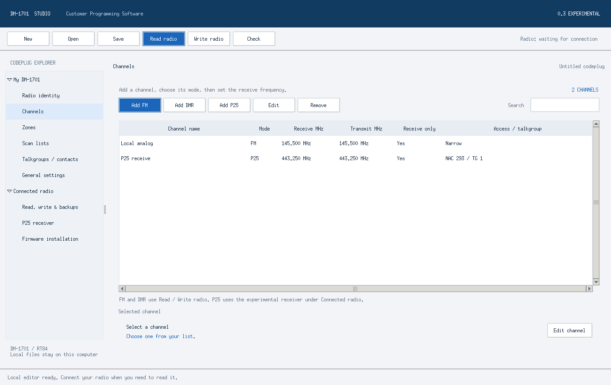

# DM-1701 Studio 0.3 — experimental P25 receiver

A complete experimental DM-1701 application image and redesigned Windows CPS.
The radio build links the C6000 receive path, P25 frame recovery/error correction,
fixed-point IMBE decoder, buffered speaker output, and a professional portable-
radio home screen. Its RF behavior is unverified.



Run **DM1701-Studio-Setup-0.3.exe**, then use the desktop shortcut. Open **Firmware
installation** to load the voice application, then **P25 receiver** to send a
frequency and NAC. [START-HERE.md](START-HERE.md) has the short instructions.

The CPS has an explorer tree, top Read/Write toolbar, structured identity/general/
zone/scan-list/contact forms, and mode-specific FM/DMR/P25 fields. Boolean options
use selections. Help → About identifies the installed copy; its title says 0.3.

The image in `firmware-voice` includes C6000 polling and automatic search of eight
bit/polarity mappings, P25 FEC, software IMBE, and a 16-block PCM queue feeding
the board's 8-kHz I2S speaker stream. The board's calibrated IF is preserved.
P25 inhibits transmission. The actual home renderer fits the 160×120 visible
panel (150×120 safe area). Hold **#** on an FM channel to toggle P25; names
beginning with `P25` request it automatically. The active profile persists.

This attempts clear conventional Phase 1 C4FM reception in the radio's VHF/UHF
bands. Boot, real-time decoding and RF/speaker operation remain unverified.
It has no trunk following, Phase 2, encryption, LSM/CQPSK, 700/800 MHz or P25 TX.
Control channels do not provide speech. FM/DMR, VFO, channel editing and scan come
from the reduced RadioFoundry base; optional networking, hotspot, repeater, APRS,
GPS and selected DMR data services are disabled to free memory.

The native P25 link reads actual receiver status and sends one active profile.
The complete project stays local. P25 talkgroup/audio selections are retained
in the project; this image receives all recovered clear talkgroups. Stock and
OpenGD77 codeplug operations require separately installed qdmr 0.13+; Windows
supports native/WSL programmers with errors saved to logs. See [WINDOWS.md](WINDOWS.md).

The new image uses a separate derivative of RadioFoundry commit
`947c1398fe85f2c0314f7749888e627270b23679`; the upstream checkout stays unchanged.
Its corresponding source archive and notices accompany the image. See
[firmware-voice/README.md](firmware-voice/README.md) and [VALIDATION.md](VALIDATION.md).

```sh
python3 -m unittest discover -s tests -v
make -C firmware-p25 test
make -C firmware-p25/voice test
python3 firmware-p25/integration/build_voice_image.py --source PINNED_RADIOFOUNDRY --cross arm-none-eabi-
```

Studio CPS is MIT licensed; P25 integration is GPL-3.0-or-later. RadioFoundry's
MIT LICENSE, AUTHORS, CONTRIBUTORS, SPDX/copyright lines and runtime notices
are retained. No proprietary donor firmware, keys or calibration data are shipped.
